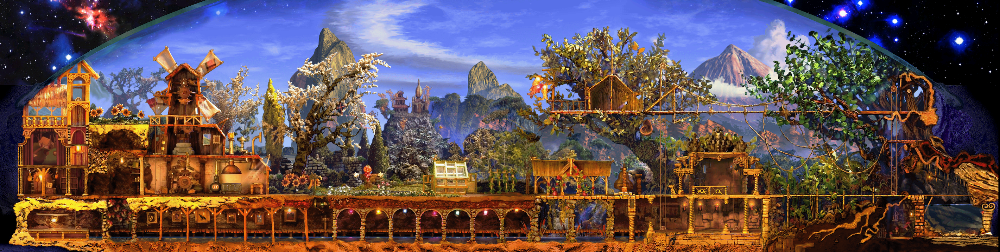

# C12DS-Lite

A trimmed down metaroom bringing the best of Creatures 1 to Docking Station

## Objective  
Metaroom aims to be more brain friendly by eliminating world wrap, horizontal movers, and ensuring agents are up to community standards

## Map Area
Map includes muusic room through to and including the Grendel tree.  
It excludes the waterfal, lovers leap, the oceans, and the island.

